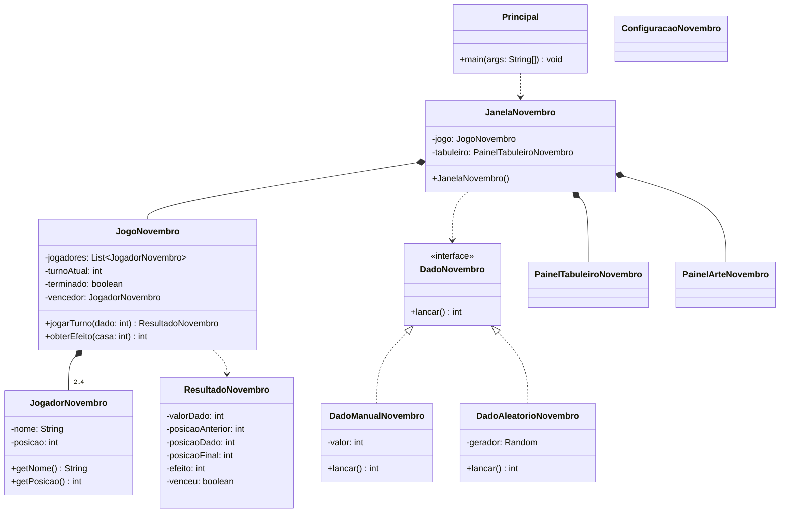

# UML de novembro — módulo autónomo

O diagrama abaixo descreve as novas classes e o ponto de entrada único `trilho.Principal`, que abre a janela Swing por defeito e mantém a demonstração simples com `--outubro`.

**Separação:** modelo não tem `JOptionPane`, `println` ou componentes Swing. Interface concentra mensagens e recebe `ResultadoNovembro`; os dados implementam uma interface simples. `JogadorNovembro` valida nomes localmente, tal como o protótipo; as constantes partilhadas estão em `ConfiguracaoNovembro` para dispensar os ficheiros de outubro.
